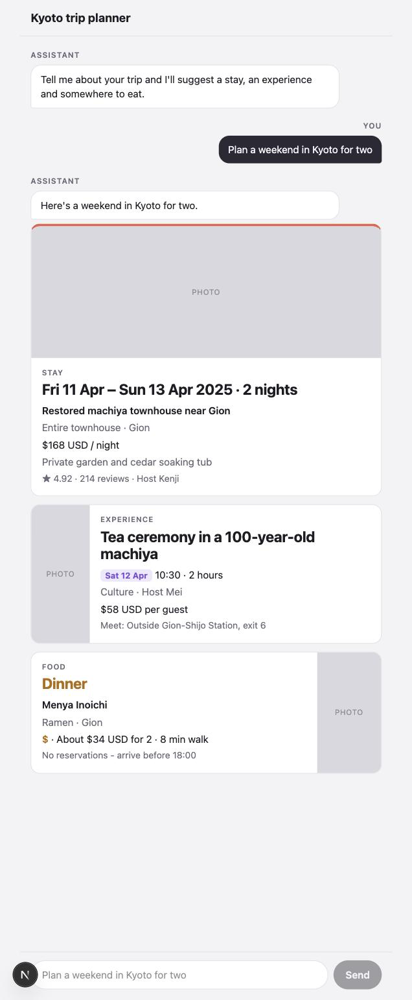

# Kyoto Trip Planner

A Next.js chat prototype that answers a trip request with stay, Experience and food cards, built from one row of each sheet in the Kyoto Weekend Prototype Content Pack.

Run it locally with `npm install && npm run dev`, then open http://localhost:3000.

The one-page card design spec is in [docs/card-spec.pdf](docs/card-spec.pdf).

## Fields that use a filler line

When one of these fields has no value in the mock response, the card shows "Not listed yet" in its place instead of a blank or "undefined" (see `components/Field.tsx`).

| Card | Fields |
| --- | --- |
| Stay | Travel dates (check-in and check-out), listing title, property type, neighbourhood, price per night, highlight, guest rating, review count, host first name |
| Experience | Experience title, date, start time, duration, category, host first name, price per guest, meeting point |
| Food | Meal type, place name, cuisine, neighbourhood, price level, estimated cost for 2, walk from stay, booking note |

In the workbook, two cells are already blank: the host name for E4 (Experiences) and the booking note for F2 (Food). Either one shows the filler line if that row is used.
