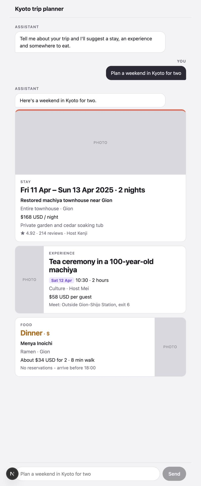

# Kyoto Trip Planner

A Next.js chat prototype that answers a trip request with stay, Experience and food cards, built from one row of each sheet in the Kyoto Weekend Prototype Content Pack.

Run it with `npm install && npm run dev`, then open http://localhost:3000.
